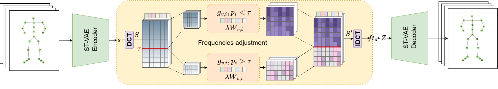
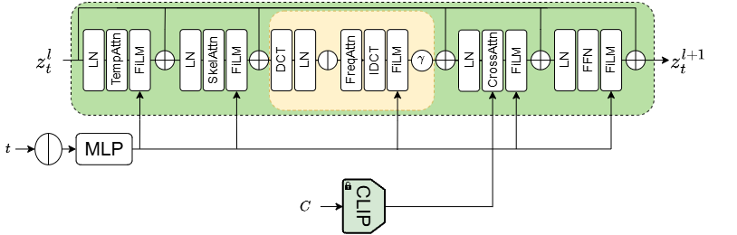

# Frequency-Aware_T2M

Frequency-aware latent diffusion for text-driven 3D human motion generation.

<!-- TODO: add a link to the paper/preprint once available. -->

We introduce frequency information into a skeleton-structured latent diffusion framework at two stages:
 
- **Frequency-enhanced VAE:** a DCT-based module refines the frequency components of the skeletal representation through learnable, body-part specific gains, shaping the latent space in which motion is generated.
- **Frequency attention:** the denoiser relates temporal frequency components directly while generating in this latent space.

This helps the model capture movement characteristics described by text, such as rapid, pronounced motions and periodic transitions between poses.

<p align="center">
    
    <br>
    <br>
    
</p>

# Environment
```bash
conda create -n freq_t2m python=3.11 -y
conda activate freq_t2m
pip install -r requirements.txt
```
Tested with Python 3.11 and PyTorch 2.5.1 + CUDA 12.1.
 
`requirements.txt` pins the CUDA 12.1 builds of PyTorch and points pip at the matching PyTorch index. For a different CUDA version or CPU-only, change the `+cu121` suffixes on `torch`, `torchvision` and `torchaudio` and the index URL on the first line, following the [official PyTorch install instructions](https://pytorch.org/get-started/previous-versions/).

# Dataset
We use the HumanML3D and KIT-ML datasets, available from the [HumanML3D repository](https://github.com/EricGuo5513/HumanML3D).
 
After downloading, copy or link them in the following structure:
 
```
Frequency-Aware_T2M
└─ dataset
    ├─ humanml3d
    └─ kit-ml
```

# 🎯 Pre-trained Weights & Evaluation Models
 
## Pre-trained Weights
We provide pre-trained weights for both the HumanML3D and KIT-ML datasets.

```
checkpoints
├─ t2m                                     # HumanML3D
│   ├─ t2m_vae_fs_dct                      # frequency-enhanced VAE
│   └─ t2m_denoiser_vae_fs_dct_freq_attn   # denoiser with frequency attention
└─ kit                                     # KIT-ML
    ├─ kit_vae_fs_dct                     
    └─ kit_denoiser_vae_fs_dct_freq_attn
```
 
<!-- TODO: add the download command or link for the weights. -->
 
## Evaluation Models and GloVe
These are needed for evaluation only:
 
```bash
bash prepare/download_evaluator.sh
bash prepare/download_glove.sh
```

</details>

# Playground
Follow ```playground.ipynb``` to enjoy text-driven motion generation and editing in Jupyter Notebook.

# Training and Evaluation
## Training from Scratch
For training VAE, follow this:
```
python train_vae.py --name vae_example --dataset_name t2m --freq_enhance dct
```

For training denoiser, follow this:
```
python train_denoiser.py --name denoiser_example --vae_name vae_example --freq_attn
```

## Evaluation
```
python test_vae.py --name vae_example
python test_denoiser.py --name denoiser_example --num_inference_timesteps 50 --cal_mm
```
Evaluated results will be saved in ```checkpoints/{vae_name | denoiser_name}/eval/eval.log```

## Acknowledgements
 
This code builds on [SALAD](https://github.com/seokhyeonhong/salad) (Skeleton-aware Latent Diffusion for text-driven motion generation and editing). We also thank the authors of [HumanML3D](https://github.com/EricGuo5513/HumanML3D) and KIT-ML for the datasets and evaluators.